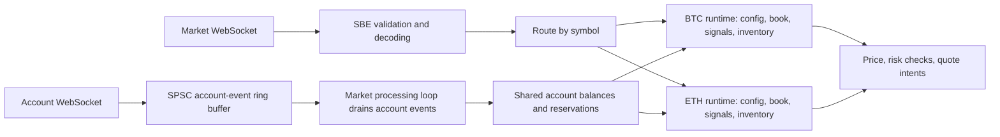

# AssumptionZero.CSharp

AssumptionZero explores a market-maker architecture built around a clear processing
flow for each exchange instrument. An instrument's configuration, order book,
signals, inventory, and quote decisions stay together, making the path from an
incoming update to a decision easier to follow.

The second aim is to compare **C# and Rust on the same hot path**: identical market
messages, strategy rules, and starting state, with correctness checked before
interpreting latency, CPU, allocation, or memory results. This is a working
processing prototype; it produces quote intents but does not submit orders.

## Architecture

The transport identifies the instrument and routes each decoded update to its
`InstrumentRuntime`. That runtime owns the state needed to process the update:



Each runtime follows **book update → signals → pricing and risk → quote intent**.
`HotConfig` is a value type held by each runtime; startup currently supplies the
same defaults to all instruments. The separation is of state and processing flow:
the current implementation uses one market processing loop, rather than a worker
thread per instrument.

- **Arrays and reusable buffers** hold book levels, rolling signal history, decode
  scratch space, and runtime lookup data. Bounded storage keeps memory use explicit
  and reduces allocations on the hot path.
- **A single-producer/single-consumer ring buffer** passes account events from the
  account WebSocket receiver to the market processing loop. That loop drains the
  events before processing a market message, so both account and market updates
  are applied on the same processing path. Queue overflow invalidates account state.
- **Shared account risk** remains in `AccountRiskLedger`: instruments trading the
  same asset must see the same available balance and reservations.
- **Startup and I/O** sit outside the decision calculations. REST snapshots and
  signing initialize live state; capture mode uses a separate channel and database
  writer. The SPSC ring buffer is specifically for live account events.

Useful entry points:

| Area | Code |
| --- | --- |
| Mode selection and startup | [Program.cs](AssumptionZero.App/Program.cs), [ExecutionRouter.cs](AssumptionZero.App/ExecutionRouter.cs) |
| Per-instrument processing | [InstrumentRuntime.cs](AssumptionZero.Application/Services/InstrumentRuntime.cs) |
| Configuration and strategy | [HotConfig.cs](AssumptionZero.Domain/InMemory/HotConfig.cs), [MarketMakingStrategy.cs](AssumptionZero.Domain/InMemory/MarketMakingStrategy.cs) |
| Market decoding and routing | [BinanceFeedReader.cs](AssumptionZero.Infrastructure/External/BinanceFeedReader.cs) |
| Account events and handoff | [BinanceAccountStream.cs](AssumptionZero.Infrastructure/External/BinanceAccountStream.cs), [SpscRingBuffer.cs](AssumptionZero.Infrastructure/SpscRingBuffer.cs) |
| Shared balances and reservations | [AccountRiskLedger.cs](AssumptionZero.Application/Services/AccountRiskLedger.cs) |

## Start the demo with Docker

Install Docker with Compose and make sure `docker info` succeeds. From the repository
root, run:

```bash
docker compose up --build --abort-on-container-exit --exit-code-from app
```

This builds the .NET applications, starts the simulator, waits for it to listen,
and connects the application using the bundled BTCUSDT starting-state fixture.
It needs **no API keys, PostgreSQL, Rust installation, or host .NET SDK**. The first
build downloads container images and NuGet packages. No host ports are needed.

Expected output includes:

```text
Replay complete: 120 decisions, ... with place/replace/cancel intents.
Products: 1 with a book, 1 ready of 1 configured.
```

The application exits successfully after the replay and Compose stops the simulator.
Run the same command again to repeat it. Remove the stopped containers with:

```bash
docker compose down
```

The demo proves the flow runs end to end. Its 120 messages are too few for a
throughput or latency-capacity claim. Use native Release builds and the
[controlled comparison runbook](docs/testing.md) for performance measurements.

## Run the tests

Using Docker:

```bash
docker compose run --build --rm tests
```

The tests cover scheduling, SBE validation, book and signal calculations, quote
rules, reservations, order-state transitions, fragmented WebSockets, repeated
replays, signing, and reports. Focused tests check zero managed allocations over
warmed processing windows; this is not a claim that the whole process allocates
nothing. Database and Rust integration tests skip when their configuration is absent.

To include the C# PostgreSQL integration test:

```bash
docker compose run --build --rm database-tests
```

This starts an isolated local PostgreSQL service. The test creates and removes its
own schema. Stop the database with `docker compose --profile database down`; its
named volume persists across restarts.

## Run without Docker

Use the .NET 10 SDK and OpenSSL on `PATH`. Commands below use Bash from the repository
root. Linux is the reference environment for benchmarks.

```bash
dotnet build AssumptionZero.sln -c Release
dotnet test AssumptionZero.Tests/AssumptionZero.Tests.csproj -c Release --no-build
```

Build the entire solution first: some tests launch the Release application
executable. If the SDK is installed in `$HOME/.dotnet`, add that directory to `PATH`.

In terminal 1:

```bash
dotnet AssumptionZero.Simulator/bin/Release/net10.0/AssumptionZero.Simulator.dll demo
```

After the simulator prints its listening address, run in terminal 2:

```bash
EXECUTION_MODE=Replay \
REPLAY_URL=ws://127.0.0.1:5080/stream \
REPLAY_FIXTURE="$PWD/AssumptionZero.App/replay-fixture.json" \
  dotnet AssumptionZero.App/bin/Release/net10.0/AssumptionZero.App.dll
```

The application exits after replay; the simulator remains available for another
connection. Stop the simulator with Ctrl+C.

## Live data and recorded replays

| `EXECUTION_MODE` | Behavior | Requirements |
| --- | --- | --- |
| `Replay` (default) | Process messages from the local simulator | Running simulator; a matching fixture is optional |
| `SeedData` | Record live SBE market messages into PostgreSQL | Testnet API key and database |
| `NormalExecution` | Load instrument/account/book snapshots, subscribe to account events, and process live market data | Testnet API key and matching Ed25519 private key |

For live processing, register an Ed25519 public key on
[Binance Spot Testnet](https://testnet.binance.vision/) and set the corresponding
API key and private-key file path:

```bash
export BINANCE_API_KEY='YOUR_TESTNET_API_KEY'
export BINANCE_ED25519_PRIVATE_KEY_PATH='/absolute/path/to/your-private-key.pem'
EXECUTION_MODE=NormalExecution \
  dotnet AssumptionZero.App/bin/Release/net10.0/AssumptionZero.App.dll
```

The signing helper uses OpenSSL and expects a private PEM file without a passphrase.
In an IDE, set the same environment variables in the run configuration. Live mode
requires both explicitly. Local signing and replay tests do not establish live
Binance connectivity or account permissions; check those with the live run.

To capture data, you can start the optional local database:

```bash
docker compose up -d database
export PG_CONNECTION='Host=localhost;Port=5433;Database=assumption_zero;Username=postgres;Password=local_test_password'
EXECUTION_MODE=SeedData \
  dotnet AssumptionZero.App/bin/Release/net10.0/AssumptionZero.App.dll
```

Keep `BINANCE_API_KEY` set for capture. Compose initializes the recording table on
the first start of its database volume. For your own database, apply
[init.sql](AssumptionZero.App/init.sql) once to a new database instead. Stop capture
with Ctrl+C and let pending writes finish before replaying it. Change `POSTGRES_PORT`
when starting Compose if host port 5433 is already occupied, and update your connection
string accordingly. The built-in database defaults elsewhere in the code are specific
to the development machine; set `PG_CONNECTION` for your environment.

See [recording and replay details](docs/replay.md) for listing recordings, replaying
from sequence one, fixture selection, timing, and optional PostgreSQL integration
tests. Set `PG_TEST_CONNECTION` separately to enable database tests outside Docker.

## Comparing C# and Rust

Both applications use the C# simulator. See [the comparison runbook](docs/testing.md)
for build scripts, paired runs, CPU affinity, and report interpretation, and
[the report schema](docs/benchmark-schema.md) for field definitions.

The C# default list currently contains **BTCUSDT, ETHUSDT, BNBUSDT, SOLUSDT, XRPUSDT**
in `AssumptionZero.App/Program.cs`. Rust's `src/symbols.json` currently contains 100
symbols. Align the lists before fixture-free comparisons. With a shared fixture,
both applications use its instruments; the bundled BTC fixture is for the demo only.

Replay without a fixture estimates balances, instrument rules, and starting books.
It exercises processing performance but cannot reconstruct historical strategy
results. Correctness hashes must agree before comparing performance. Repository
paths, database addresses, recording IDs, and CPU IDs in the runbook are examples
from the development machine and need to match your setup.

To enable the Rust integration tests after building its Release executable:

```bash
export RUST_APP_TEST='/absolute/path/to/assumption-zero/target/release/assumption-zero'
dotnet test AssumptionZero.Tests/AssumptionZero.Tests.csproj -c Release --no-build
```
